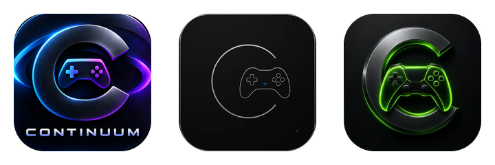

# Continuum

Continuum is an all-in-one emulator for iPhone: dozens of systems in one app, from the NES to the
Nintendo 3DS. It's free and open source, and it's in public beta, so expect a few rough edges. It
isn't on the App Store: you install it yourself.

## Getting it

1. Open the [latest release](https://github.com/2c2bhdhw9z-cell/Continuum-/releases/latest) and
   download `Continuum-<number>.ipa`. The plain `Continuum.ipa` next to it is the same app.
2. Sign and install it with the sideloading app you normally use and your own certificate.

It needs iOS 16 or later. Your version number is in Settings, About.

Games and BIOS files aren't included. You'll need your own.

## What it plays

### Played on an iPhone

| System | Emulator |
| --- | --- |
| NES | Mesen, or FCEUmm |
| SNES | bsnes, or Mesen |
| Game Boy, Game Boy Color, Game Boy Advance | mGBA, or cBoy |
| Game Gear | Gearsystem |
| Mega Drive / Genesis | BlastEm |
| PlayStation | PCSX ReARMed, or Beetle PSX |
| Nintendo 64 | ParaLLEl N64 |
| Nintendo DS | melonDS |
| Nintendo 3DS | Azahar |
| TurboGrafx-16 / PC Engine | Beetle PCE Fast |
| Atari 2600 | Stella |
| Atari Jaguar | Virtual Jaguar |
| Pokémon Mini | PokeMini |

### In the app, not much tested yet

| System | Emulator |
| --- | --- |
| PSP | PPSSPP |
| Dreamcast | Flycast |
| Saturn | Yabause, or Beetle Saturn |
| Sega CD, 32X | BlastEm |
| Arcade | cArcade (Continuum's own) |
| Master System, SG-1000 | Gearsystem |
| Famicom Disk System | FCEUmm, or Mesen |
| PC Engine CD | Beetle PCE |
| SuperGrafx | Beetle SuperGrafx |
| WonderSwan | Beetle WonderSwan |
| Neo Geo Pocket | Beetle NeoPop |
| Atari Lynx | Handy |
| Atari 7800 | ProSystem |
| Atari 5200 | a5200 |
| Virtual Boy | Beetle VB |
| Commodore 64 | VICE |
| Amiga | PUAE |
| DOS | DOSBox Pure |
| DOOM | PrBoom |
| Flash games (.swf) | Ruffle |
| Old Java phone games (.jar) | J2meJS |

A few things to know:

- 3DS games have to be decrypted, and there can be a short stutter after a scene change.
- 32X games don't need a BIOS.
- Arcade games are zip sets, like pacman.zip. Continuum's own arcade emulator plays Pac-Man and
  Ms. Pac-Man, Galaxian and Moon Cresta, and Konami's Scramble, Super Cobra, Frogger and Amidar,
  plus their clones. Other arcade games stay in your library until it can play them.
  <!-- ARCADE: Donkey Kong pending, the orchestrator fills this in -->
- GameCube, Wii and Switch aren't supported.
- Everything runs without JIT, but the heavier systems can be slow. If your setup can turn JIT on
  (with StikDebug or a similar tool), Continuum should pick it up by itself. That part is new and
  no tester has tried it yet. Settings, Technical details shows whether it's on.

## What it does

- Save states, 50 slots per game with a picture each, and auto-save, so a game picks up where
  you left it
- Rewind, fast forward up to 4x, and slow motion
- Delta skins for the touch controls, and Manic skins too (newer, less tested). There's a
  [skin guide](docs/DELTA_SKIN_FORMAT.md) if you make your own
- Game controllers, even together with the touch controls
- Cheat codes and RetroAchievements
- Screen filters, like a CRT look and an LCD grid
- Your game on a TV with AirPlay
- Both screens for DS and 3DS games, in a few layouts
- Cover art for your library
- Online play with a second phone (new, so it hasn't had much testing)

## Continuum's own emulators

Most systems run on well-known open-source emulators. Two are Continuum's own, written from
scratch in Rust:

- **cBoy**: one emulator for Game Boy, Game Boy Color and Game Boy Advance. It's newer than mGBA,
  so mGBA is still the default, and you can switch to cBoy in Settings. Game Boy games have played
  on it on an iPhone. Advance games on cBoy are still early.
- **cArcade**: the arcade emulator. It's brand new, so arcade games haven't had much testing yet.

## Adding games

Tap the + button in the library and pick your files (zip and 7z work too). For a disc game made
of a .cue and .bin files, pick the .cue and every .bin together. You can also put files in the
Files app under On My iPhone, Continuum. Press and hold + for Wi-Fi transfer from a computer,
pasting, and WebDAV servers.

If a game needs a BIOS file, it tells you which one when you open it. Put the file in the same
Continuum folder, then go to Settings, BIOS and tap Install a BIOS from the Continuum folder.

## Feedback

It's a beta, so reports really help. Trying a system from the less-tested list, or a game nobody
has tried, helps most.

- In a game: tap ⋯, then Send feedback about this game. You can rate how it runs and draw on a
  screenshot to show what's wrong.
- Anything else: Settings, Send feedback.
- If the app closes by itself, it offers to send a crash report the next time you open it.

Reports go by email to ContinuumDev2c2b@gmail.com, and you see the whole message before it's
sent. You can also just write to that address.

## Credits and licence

Continuum is licensed under the GNU General Public License v3.0. See [LICENSE](LICENSE).

It's built on a lot of other people's work, so a big thank you to everyone who makes the
emulators and libraries inside it. Each one keeps its own licence. The full list, with each
licence and a link to the source code, is in the app under Settings, About, Open-source credits.
None of those licences limits what the app does or what it costs. They ask for credit, and for
the source code to stay public.

## The code

- [native/ios](native/ios): the iPhone app, in SwiftUI
- [crates/emulator-bridge](crates/emulator-bridge): the engine, in Rust. It runs the emulators
  as libretro cores
- [cores/continuum-gb](cores/continuum-gb): cBoy
- [cores/continuum-arcade](cores/continuum-arcade): cArcade

The app is built by GitHub Actions, and every new build is published on the
[Releases](https://github.com/2c2bhdhw9z-cell/Continuum-/releases) page.
